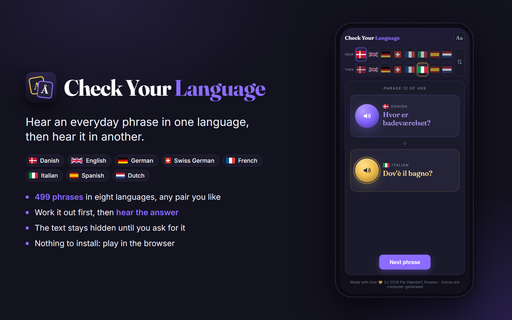

# Check Your Language

[](https://kreaton.github.io/CheckYourLanguage/)
[](LICENSE)


[](https://github.com/kreaton/CheckYourLanguage/stargazers)

⭐ If Check Your Language earns a place on your machine, [star it on GitHub](https://github.com/kreaton/CheckYourLanguage) — it's free, made by one developer, and stars are how other people find it.



**Hear everyday phrases in one language, then in another: Danish, English, German, Swiss German,
French, Italian, Spanish and Dutch.**

**Play it: <https://kreaton.github.io/CheckYourLanguage/>**

A sibling of [Check Your Nouns](https://github.com/kreaton/CheckYourNouns) and
[Check Your Numbers](https://github.com/kreaton/CheckYourNumbers), with the same look.

*Swiss German* is Swiss Standard German: a Swiss voice saying standard German. Its code and folder
are `ch`.

## How it works

1. Pick the language to hear first (**Hear**, violet) and the one to hear it in next (**Then**, gold).
   Picking a language that is already in the other row swaps the two, and ⇅ swaps them as well.
2. **Start**: a random phrase is spoken in the first language. Work out what it means, or how you
   would say it in the second.
3. **Hear it in …**: the same phrase is spoken in the second language.
4. **Next phrase**, or **Skip** before hearing the second language.

The text of each side stays hidden until **Show text** is clicked. **Aa** in the top bar shows the
text straight away instead.

- Tapping a speaker plays that side again.
- Phrases come in random order, and every one comes once before any repeats.
- The two languages and the **Aa** setting are kept in the browser.

### Keyboard

| Key | Does |
|---|---|
| `Enter` | Start, hear it in the second language, next phrase |
| `Space` | Play the last one again |
| `T` | Show the text |
| `1` / `2` | Play the first / second language |

## Phrases and recordings

The phrases and recordings come from a `lydfiler` folder next to the `WebAssembly` folder
(`repos2026-2/lydfiler`):

- `phrases-all.csv`: one column per language code (`en,da,fr,it,es,nl,de,ch`), one phrase per row,
  with the same meaning across a row.
- `audio/<code>/<file>.mp3`: the phrase spoken. The file name is the phrase in lower case without
  accents (*æ, ø, å* become *ae, oe, aa*), with every run of other characters than letters, digits,
  `_` and `-` turned into one `_`: *j'ai une question* is `j_ai_une_question.mp3`.

`tools/import-phrases.ps1` turns these into `CheckYourLanguage/wwwroot/phrases.json` and copies the
recordings to `CheckYourLanguage/wwwroot/audio/<code>/`. It stops without changing anything if a
recording is missing, and removes recordings that are no longer used.

```powershell
powershell -File tools\import-phrases.ps1
```

`-Source <folder>` reads another folder than `..\..\lydfiler`.

A file name that Windows reserves for a device (`con`, `nul`, `com1`, …) gets a trailing `_` in the
app, as git and the build cannot handle such files on Windows: Italian and Spanish *con* ("with") is
`con_.mp3`.

A language needs an entry in [`Game/Language.cs`](CheckYourLanguage/Game/Language.cs) (name and
flag) to be shown; a column in the CSV without one is left out.

## Run

```bash
dotnet run --project CheckYourLanguage
```

The app then runs at http://localhost:5163.

## Icons

The app icon (iOS home screen, Windows/Android install via the web app manifest, and the browser
favicon) is drawn by a script into `CheckYourLanguage/wwwroot/icons` and `wwwroot/favicon.ico`:

```powershell
powershell -File tools\make-icons.ps1
```

The README banner (`images/banner.png`) is `tools/banner.html` rendered by headless Edge. Its phone
is `tools/banner-phone.html`: the app's own markup and stylesheet after a phrase has been heard in
both languages.

```powershell
powershell -File tools\make-banner.ps1
```

## Version

`Directory.Build.props` sets the version: Major.Minor by hand, and the patch is the GitHub Actions
run number (0 for local builds). The footer shows the version, build time and git commit.

## Deploy

`.github/workflows/deploy.yml` publishes to [GitHub Pages](https://kreaton.github.io/CheckYourLanguage/)
on every push to `main` (or manually from the Actions tab). The page uses a relative
`<base href="./">`, so it works in any folder.

## License & Authorship

This project is distributed under the terms of the [MIT License](LICENSE), except the recordings;
see [THIRD-PARTY-NOTICES.md](THIRD-PARTY-NOTICES.md).

**AI authorship note:** Most of the source code in this repository was generated with AI coding agents (Claude Code), under my direction and review. Purely AI-generated material may not be eligible for copyright protection in some jurisdictions. To the extent any part of this project is protected by copyright, it is licensed under the MIT License, and the license's warranty and liability disclaimers apply to the project as a whole.

<!-- notices:start -->
### Independent development

CheckYourLanguage is an independent, personal project developed by Per Hejndorf. It is not affiliated with, endorsed by or sponsored by Microsoft or any other rights holder (including Google). Product names and logos are trademarks of their respective owners and are used only to identify the services and tools the project works with.

### Third-party notices and asset provenance

[THIRD-PARTY-NOTICES.md](THIRD-PARTY-NOTICES.md) lists every third-party library, font and online service the project uses, with version, licence, source and whether it was modified. It also records where the icons, images, audio and video came from and how they are licensed.
<!-- notices:end -->
